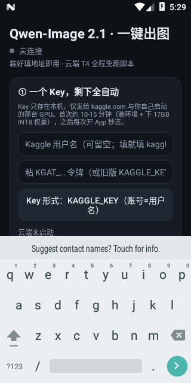
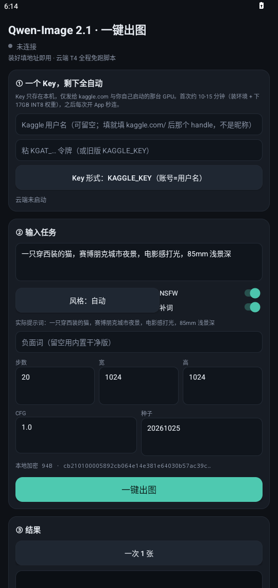

# Qwen-Image-2.1 Uncensored · 一键出图

Kaggle 免费 GPU 跑 `Qwen-Image-2.1-Uncensored` 的 **INT8** 量化版，Android 一个按钮走完全流程。


*T4 上 20 步 1024×1024，236 秒。上面的图就是 `docs/run_summary.json` 里那次运行的产物。*

这是**一张**的数。要看 9 张、要看这个数落在一个什么区间里，用 `kaggle/gen_batch.py`
（见[下一节](#9-张一起跑)），它把单张墙钟记进 `docs/bench/batch.json`。

## 目录

```
kaggle/          Kaggle 端：ComfyUI + 加密节点 + 出图/常驻服务
android/         APK 源码（纯 Java，不依赖 AndroidX/Gradle）+ 一条命令构建
apk/             已签名安装包（预编译，直接装）
docs/            实测产物（出图、密文图、运行摘要）
```

## 模型

[abenzerps/Qwen-Image-2.1-Uncensored-Quantized](https://huggingface.co/abenzerps/Qwen-Image-2.1-Uncensored-Quantized) 的 int8_convrot 三件套：

| 组件 | 文件 | 大小 |
| --- | --- | ---: |
| Diffusion | `qwen-image-2.1-UC-int8_convrot.safetensors` | 6.76 GB |
| Text Encoder | `text_encoders/qwen3vl_8b_int8_convrot.safetensors` | 9.35 GB |
| VAE | `vae/qwen_image_2.1_vae_bf16.safetensors` | 676 MB |

T4 16G 够用：diffusion 进显存，TE 走 RAM——编码只发生一次，几乎不掉速。
走 hf-mirror 下载，17GB 约 2 分钟。

## Kaggle 端

一般不用手动跑，APK 会自己 push。想自己起或调试时：

```bash
cd kaggle && kaggle kernels push
```

云端逻辑只写在 `kaggle/qwen_setup.py`（全部逻辑）+ `kaggle/run_notebook.py`（启动序列）里，
`notebook.ipynb` 与 APK 内置的那份 `Kernel.java` 都是生成的：

```bash
python3 kaggle/gen_kernel.py           # 重新生成 ipynb + Kernel.java
python3 kaggle/gen_kernel.py --check   # 校验两份产物是否与源码同源
```

别手改 `.ipynb`。以前两边各存一份拷贝，改了一边另一边还是旧的，
结果是「脚本改了、手机上推上去的仍是老云端代码」。

加速器 **GPU T4**，Internet 打开。跑起来后依次做：装环境 → 拉权重 → 起 ComfyUI →
装加密节点 → 闭环自检（密文图 + 任务信封双向验证）→ 开公网隧道 → 把地址发布到日志。

日志里那行是给手机看的：

```
QWEN21://<base64url({"kind":"ready","url":"https://xxxx.trycloudflare.com","token":"QW21-…"})>
```

为什么走日志：Kaggle 没有「读某个 kernel 最新版本输出文件」的公开 API，但有日志。
地址是唯一必须由云端告诉手机的变量（Quick Tunnel 每次重启都换域名）。
想要固定域名，把 `NGROK_TOKEN` 放进 Kaggle Secrets，会自动优先走 ngrok。

两个容易被忽略的设置：

- **大件都放 /tmp**。Kaggle 保存版本时 output 有 ~20GB 上限，17GB 权重放在 working
  会让保存直接失败，日志也跟着丢，自续跑就断了。
- **依赖不重装**。镜像自带 torch/numpy/transformers/aiohttp/pillow/safetensors/einops，
  自定义节点只用得到 numpy/torch/PIL，所以 `pip` 只补缺的那几个，绝不碰 torch。

## APK（已编译，直接装）

安装包在仓库里：**[`apk/qwen-image-2.1-oneclick.apk`](apk/qwen-image-2.1-oneclick.apk)**（81 KB，minSdk 24，已签名）。

**装好只需要填一个 Kaggle API Key。** 没有云端地址，没有口令，没有 push 命令，没有构建脚本。

新版 Kaggle 设置页只给一个 `KGAT_…` 令牌：粘进去就行，用户名留空、由 `hello` 自己认出账号；
连 `export KAGGLE_API_TOKEN=…` 整行、`echo … > ~/.kaggle/access_token` 整行贴进去也能认。
用户名可留空；真要填，填的是 `kaggle.com/` 后面那个 handle，不是昵称。

填对了还被判「Key 无效」，是两次都错在「太信一句话」：

- 第一次是拦在门口——旧式 key 硬要两个字段，`KGAT_` 却有它认不出的前缀特征；
- 第二次是判得太早——`hello` 只是个探测点，一旦它回 401 就整条链路判死。

现在的规矩：**`hello` 只回答「探到没有」**。探不到（401/403/404/超时都一样）就退回用户填的名字，
再退到 Kaggle 自己的 `me`，直接把内核推上去，让真正做事的那几个接口说话。
入口只拦真正为空的字段，凭据真伪交给 Kaggle 判断，本地只打一行「看起来像什么」。

点一次「一键出图」，手机自己干这些事：

1. `hello` 探出 Key 属于哪个账号（不用你填用户名）
2. `kernels/push` 起或复用你名下的 GPU 会话（内核代码编译进 APK，离线也能推）
3. 轮询内核日志，等云端把隧道地址和设备令牌写下来（`QWEN21://…` 那一行）
4. 探活通过后，端上封一个加密信封提交出图
5. 取回图片，存相册

首次约 10-15 分钟（装 ComfyUI + 拉 17GB INT8 权重），之后每次开 App 秒连；
云端快到期时会自己 push 新版本续跑，手机不用管。

装好后还能调：风格预设 8 种、NSFW 开关、补词开关、实际提示词预览、
步数 / 宽高 / CFG / 种子（定值可复现）、一次 1/2/4 张、缩略图切换、存相册（`Pictures/Qwen21/`）。

### 自己编译

```bash
cd android && ./build.sh
```

只要机器上有 `javac`，SDK 缺失会自动下载到 `android/.sdk/`，产出直接覆盖 `apk/` 里那一份。
签名用固定的 `android/.keystore`（首次自动生成），所以升级安装不会因签名变化被系统拒掉。

## 9 张一起跑

`docs/run_summary.json` 是 1 张的成绩：236.2 秒。单个数说服力有限——它可能是那天的
隧道特别顺，也可能是那一张恰好简单。所以另有一个脚本，跑 9 张，每张的墙钟都留着。

```bash
# 已经知道地址（云端日志里那行 QWEN21:// 里的 url / token）
python3 kaggle/gen_batch.py --url https://xxxx.trycloudflare.com --token QW21-xxxx

# 只知道自己 push 上去的 slug：脚本自己读内核日志把地址捞出来（用你的 KGAT_ 令牌）
python3 kaggle/gen_batch.py --wait --slug <owner>/<kernel-slug> --key KGAT_xxxx

# 不出网，只验本地信封
python3 kaggle/gen_batch.py --dry-run
```

它跟 APK 走的是同一条路：端上封信封 → `POST /qwen/generate` → 轮询 `/qwen/task` →
`/view` 取图。**计时从封包前开始，到图片落盘为止**——这段才是用户在等的墙钟时间，
不是云端自己报的 `elapsed`（那个不包含排队、隧道和取图）。

9 张不是同一句提示词点 9 次：

- 5 张是**同一句**猫（`docs/run_summary.json` 那句），只换种子——看同一份工作流换 seed
  时耗时抖多少。同一个种子再跑一次，出的图应该逐像素一致。
- 另外 4 张换题材（拉面摊、雪山、蜂鸟、水乡、雷暴里取），看耗时是否跟内容相关——
  采样步数一样就该基本无关；相关的话，瓶颈就不在采样上。

产物：`docs/bench/q01.png … q09.png`，外加 `batch.json`（逐张 seed / 提示词 / 秒数 / 字节数，
以及总墙钟、单张均值和极值）。全成功退出码 0，有失败是 1，失败那张的 `error` 也会写进 `batch.json`
——不然一张失败只会让人重跑整轮，然后忘掉它怎么挂的。

**这一节现在还没有真数字。** 写这段的时候手上没有能跑 T4 的 Key，也没有 GPU：
本机 `nvidia-smi` 不存在、`torch` 没装、`~/.kaggle` 空着。拿一张图冒充九张、
把 236.2 抄九遍，比不写更坏——所以先留白。跑完那条命令，`batch.json` 一出来，这张表就能填：

<!-- BENCH:TABLE -->

图在 `docs/bench/` 里，表格按 `batch.json` 生成，别手写数字。

## 加密链路

`comfy_node_crypt` 是 ComfyUI 原生 custom node，不是外挂：

- `EncryptText`：明文 → 4 轮 ARX Feistel（8 字节分组 PKCS#7）→ 每个字节展开成 16 位码字 → 位反转铺进 32×32 起的方形图
- `DecryptText`：从图里读回码字，逆向还原
- APK 的 `Crypto.java` 是独立实现，seed 编译进包里，明文不出设备

上一版只把提示词装进密文，步数、尺寸、种子、负面词还是明文 JSON 过网。现在整条指令走一个信封：

```
CB 22 01 00 | len(2) | Feistel( b"Q2" | n × [klen key vlen type payload] )
```

云端 `/qwen/generate` 现拆现拼工作流，解密后的提示词只活在进程内存里，
不打印、不落盘。`/qwen/health`、`/qwen/task/{id}` 只回状态与文件名。

边长取 2 的幂，位反转才是严格双射；码字多时边长自动翻倍。


*72 个码字铺在 32×32 里。上面这张就是这次实测的密文图，肉眼读不出内容。*

已做双向交叉验证：Java 码字 → Python 图 → Java 读回，以及反向；中英日韩 + emoji + 换行 + 符号全部字节级一致。

**推送时账号必须是真的 handle。** `kernels/push` 的 slug 由 `owner/kernel-slug` 拼成，
owner 若是 `me`（hello 没探出账号时的兜底），Kaggle 回的是 `400 {"message":"A language must be specified."}`
——它先校验 slug、再报下一条必填项，所以这句抱怨跟语言无关。现在的顺序是：
`hello` 探到就用它，探不到就去 `kernels/list` 反查 Key 名下第一个内核的 `ownerSlug`，
两条都空就**不推**，直接说"把 handle 填进用户名那格"，而不是推个 `me/` 上去换一句听不懂的话。
载荷里 `language` 同时写在 `source.language` 与 `source.slug.language`，`name`/`id` 成对给。

## 装到设备上实测过

不是「应该能装」，是真装上去跑过：Android 7.0（minSdk 24 下限）与 Android 14（targetSdk 34 上限）
各起一台 x86_64 模拟器，`adb install` 直装仓库里这个 APK。

| | Android 7.0 | Android 14 |
| --- | --- | --- |
| 安装 | Success | Success |
| 启动 | 无崩溃，UI 全渲染 | 无崩溃，splash 走完进主界面 |
| 首屏 |  |  |

装下去第一眼就是这个（Android 14）：


顺带把端上那条本地路径也验了：默认提示词在设备上现封密文是
`cb210100005892cb064e14e381e64030b57ac39c…`（94B），
`kaggle/verify_seal.py` 用独立 Python 实现算同一份输入，**字节级相同**。
这个脚本能直接跑，不依赖 Android：

```bash
python3 kaggle/verify_seal.py    # 密文 + 信封 packTask 双向校验
```

没 Key 就点「一键出图」，也不会崩：状态灯转红「失败」，日志写
`出错: 先填 Kaggle API Key（KGAT_ 开头那个令牌，粘 export 整行也行）`，
按钮自己复位。这条也截了图：`docs/device/a14-log-nokey.png`。

## 已知边界

- **首次要等**：装环境 + 17GB 权重约 10-15 分钟，这不是 APK 能优化的部分。
- **9 张不一定是 9×236 秒**。236 秒是走完「封包→排队→采样→取图」一整圈的墙钟，
  连跑时哪一段被摊薄、哪一段不摊薄，只能看 `docs/bench/batch.json` 的量出来的数。
- **单次会话上限 12 小时**：到期前云端自己 push 新版本接棒，旧会话优雅退出。
  重启后要重新下权重（这就是上面说的 /tmp 取舍换来的可靠续跑）。
- **真 GPU 推理没在设备上端到端跑过**：设备侧验到的是
  ①安装/启动/UI 渲染（A7 + A14 双版本实拍）②设备内密文与独立 Python 实现字节级一致
  ③无 Key 的失败路径优雅收场。再往后要 Kaggle 账号：`kernels/push` 起 T4、
  等隧道地址下发、出图取回，那一段需要真 Key 才能走，模拟器替不了。
- **模拟器无 KVM 时极慢**：本次宿主没有 `/dev/kvm`，全程 QEMU TCG 纯软件模拟，
  Android 14 冷启约 5 分钟、偶发系统级 ANR 弹窗（是 `process system` / `System UI`
  超时，不是本 App）。这台机器上的截图因此拍得比较费劲，但 App 本身进程始终存活、界面正常。

**日志要能指到具体的字节。** 之前 push 失败只留一句「被拒」，日志里看不到发给谁、Kaggle 的原话是什么，
最后还得让人把日志贴出来问。现在 push 会先记一行「push → owner/slug」，再记一行「push 回 HTTP xxx：原话」；
`hello` 探到谁、`kernels/list` 反查回几号、读日志被拒的 HTTP 码，也都各占一行。
账号探不到时不再静默退回 `me`：那一步会说「反查账号：kernels/list 回 HTTP 401」，一眼看出是令牌不认这个接口。
